<div align="center">


# k-pdf

### PDFs, without the wait.

A fast, lightweight PDF viewer and editor for Windows, macOS and Linux.<br>
Read, edit, sign, fill in, scan, redact and compress, in an app that opens in a fraction of a second.

[](../../releases/latest)
[](../../releases)
[](#download)
[](#license)
[](../../stargazers)

**[Download](../../releases/latest)** &nbsp;·&nbsp; **[Website](https://kabilanma.github.io/k-pdf/)** &nbsp;·&nbsp; **[Illustrated guide](https://kabilanma.github.io/k-pdf/guide.html)** &nbsp;·&nbsp; **[What's new](https://kabilanma.github.io/k-pdf/news.html)**

<br>

<picture><source media="(prefers-color-scheme: dark)" srcset="site/static/images/sections-dark.webp">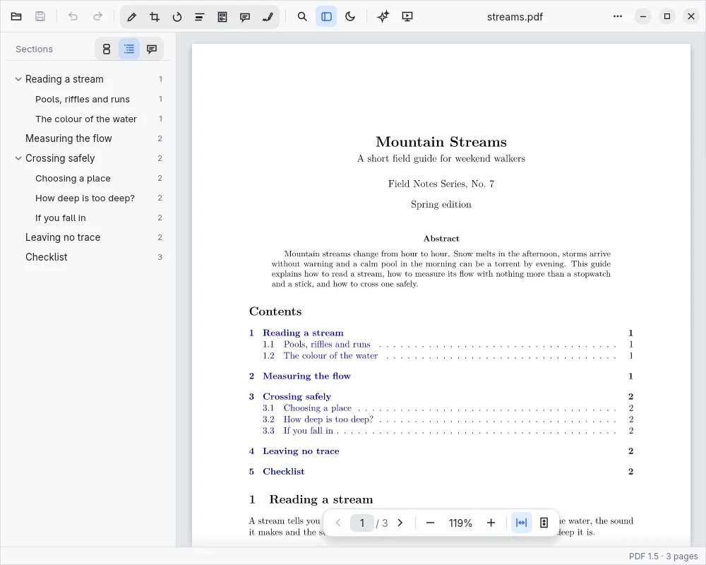</picture>

<br>

<table>
  <tr>
    <td align="center" width="25%"><h2>0.1–0.4 s</h2>to open a document</td>
    <td align="center" width="25%"><h2>2.5×</h2>faster page drawing than MuPDF</td>
    <td align="center" width="25%"><h2>10×</h2>faster text extraction</td>
    <td align="center" width="25%"><h2>Free</h2>and open source</td>
  </tr>
</table>

</div>

## Everything you do with PDFs, in one small app

Click any feature to see how it works in the [guide](https://kabilanma.github.io/k-pdf/guide.html).

<table>
  <tr>
    <td width="33%" valign="top">
      <a href="https://kabilanma.github.io/k-pdf/guide.html#reading"><picture><source media="(prefers-color-scheme: dark)" srcset="site/static/images/read-dark.webp">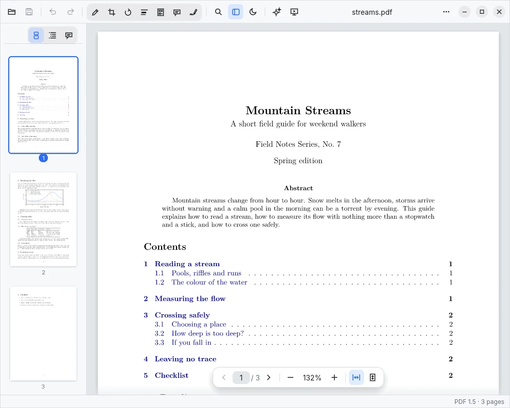</picture></a>
      <h3>Read comfortably</h3>
      Smooth scrolling, thumbnails, sections, and it remembers where you stopped.
    </td>
    <td width="33%" valign="top">
      <a href="https://kabilanma.github.io/k-pdf/guide.html#search"><picture><source media="(prefers-color-scheme: dark)" srcset="site/static/images/search-dark.webp">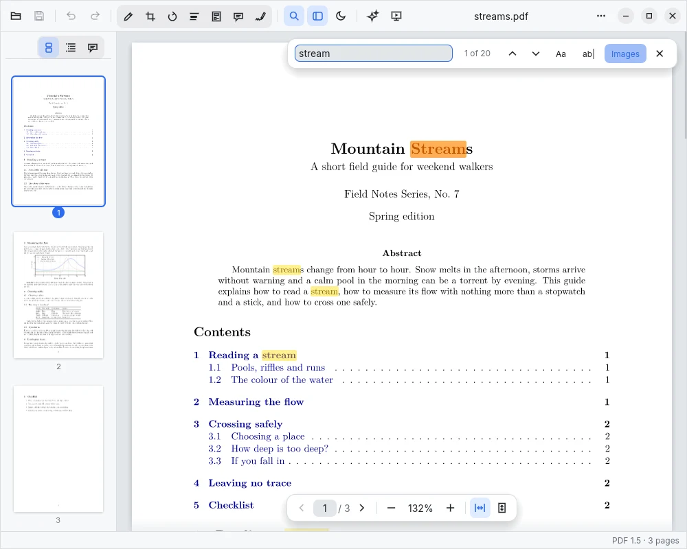</picture></a>
      <h3>Find words, even in scans</h3>
      Search every page, including scans and photos, with built-in OCR.
    </td>
    <td width="33%" valign="top">
      <a href="https://kabilanma.github.io/k-pdf/guide.html#edit-text"><picture><source media="(prefers-color-scheme: dark)" srcset="site/static/images/edit-dark.webp">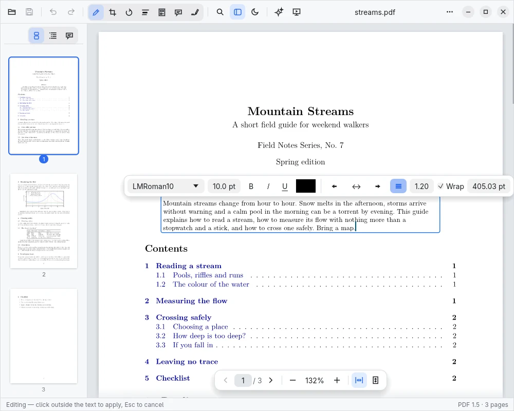</picture></a>
      <h3>Edit text</h3>
      Click any paragraph and type. Font, size and color are kept.
    </td>
  </tr>
  <tr>
    <td width="33%" valign="top">
      <a href="https://kabilanma.github.io/k-pdf/guide.html#highlight"><picture><source media="(prefers-color-scheme: dark)" srcset="site/static/images/comment-dark.webp">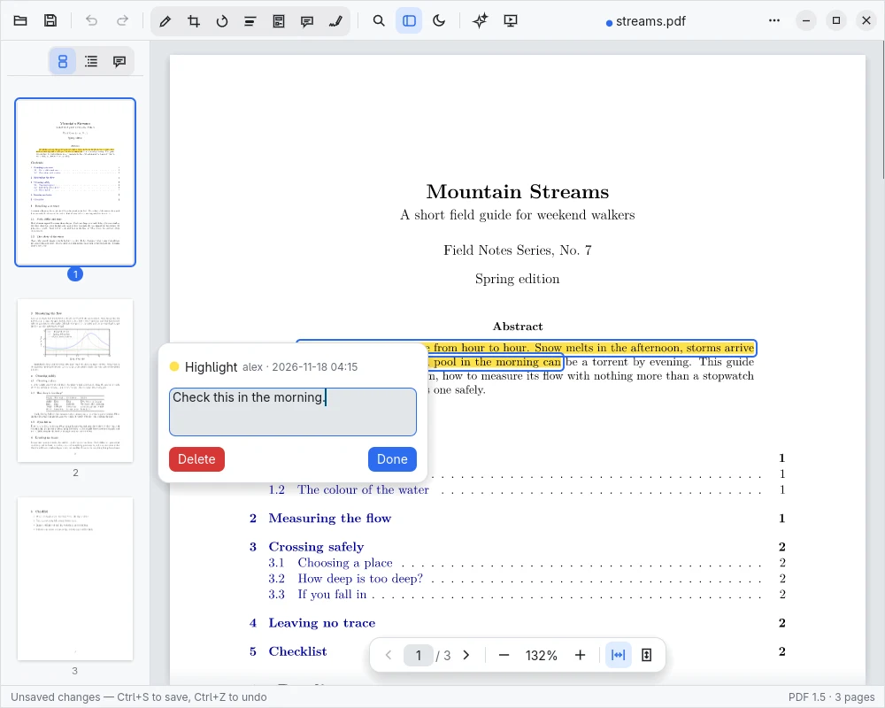</picture></a>
      <h3>Highlight and comment</h3>
      Four highlight colors and notes, saved as standard PDF comments.
    </td>
    <td width="33%" valign="top">
      <a href="https://kabilanma.github.io/k-pdf/guide.html#fill-forms"><picture><source media="(prefers-color-scheme: dark)" srcset="site/static/images/form-fill-dark.webp">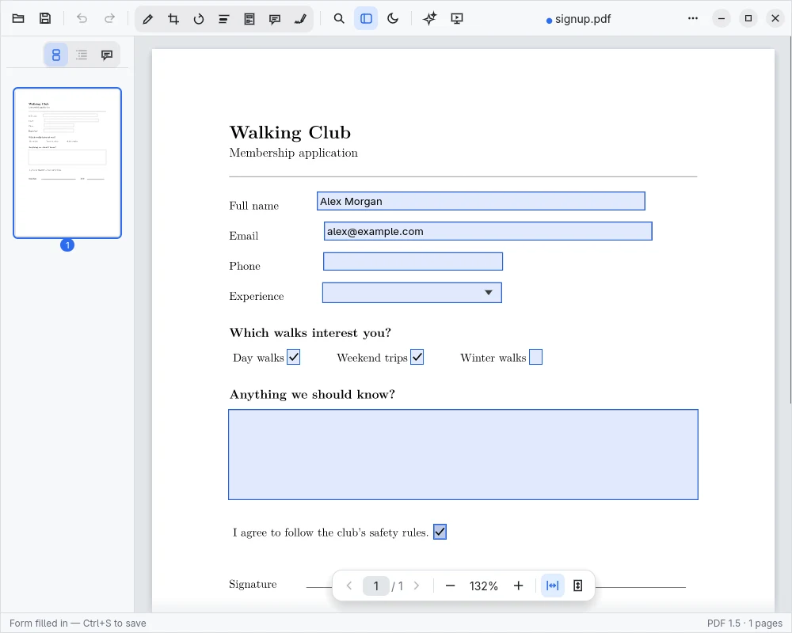</picture></a>
      <h3>Fill in and create forms</h3>
      Fill in any form, or turn a paper form into one people can fill in.
    </td>
    <td width="33%" valign="top">
      <a href="https://kabilanma.github.io/k-pdf/guide.html#sign"><picture><source media="(prefers-color-scheme: dark)" srcset="site/static/images/sign-dark.webp">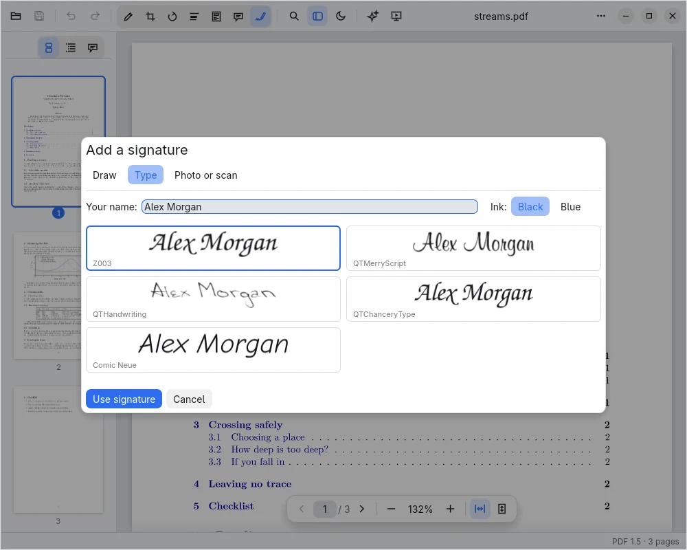</picture></a>
      <h3>Sign</h3>
      Draw your signature, type it, or take it from a photo.
    </td>
  </tr>
  <tr>
    <td width="33%" valign="top">
      <a href="https://kabilanma.github.io/k-pdf/guide.html#images"><picture><source media="(prefers-color-scheme: dark)" srcset="site/static/images/scan-dark.webp">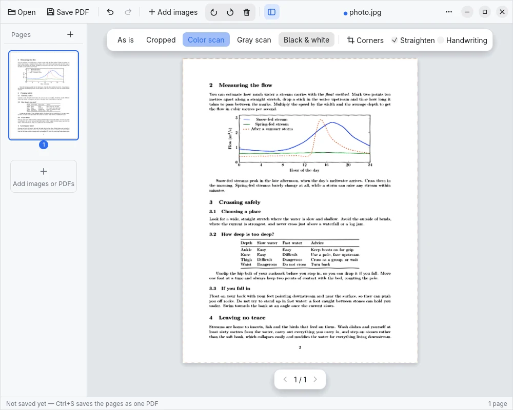</picture></a>
      <h3>Scan with your phone</h3>
      Photos of documents become clean, flat, scanned pages.
    </td>
    <td width="33%" valign="top">
      <a href="https://kabilanma.github.io/k-pdf/guide.html#clean-up"><picture><source media="(prefers-color-scheme: dark)" srcset="site/static/images/cleanup-dark.webp">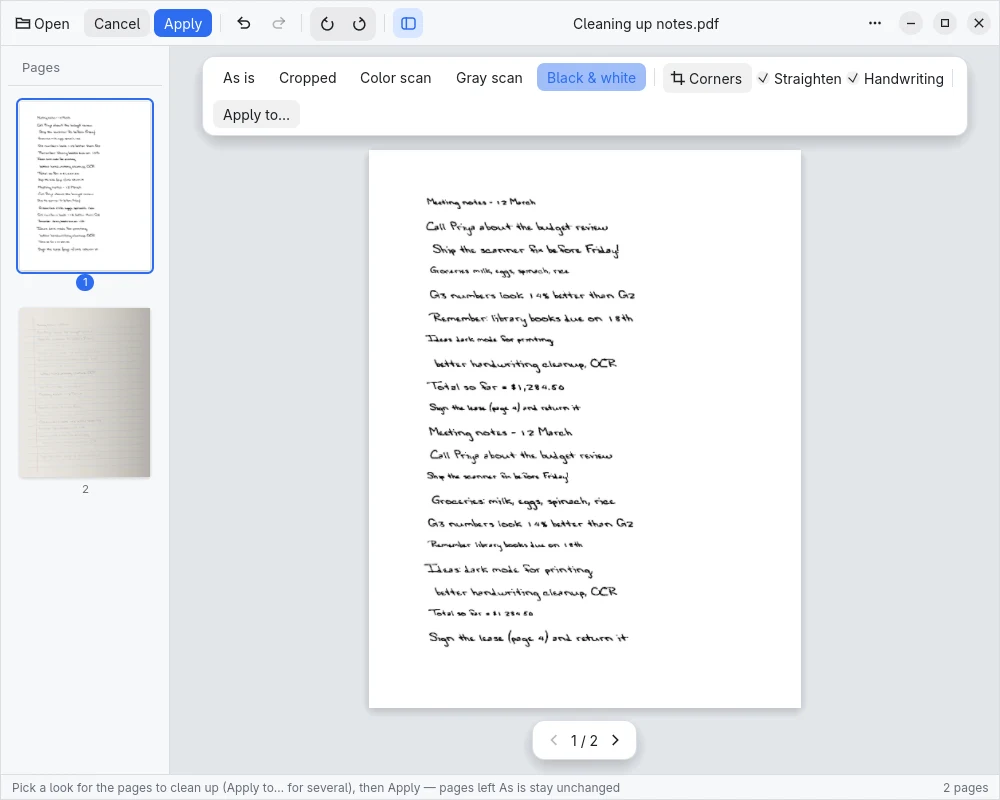</picture></a>
      <h3>Clean up handwritten notes</h3>
      Faint pencil and blotchy scans become crisp and easy to read.
    </td>
    <td width="33%" valign="top">
      <a href="https://kabilanma.github.io/k-pdf/guide.html#redact"><picture><source media="(prefers-color-scheme: dark)" srcset="site/static/images/redact-dark.webp">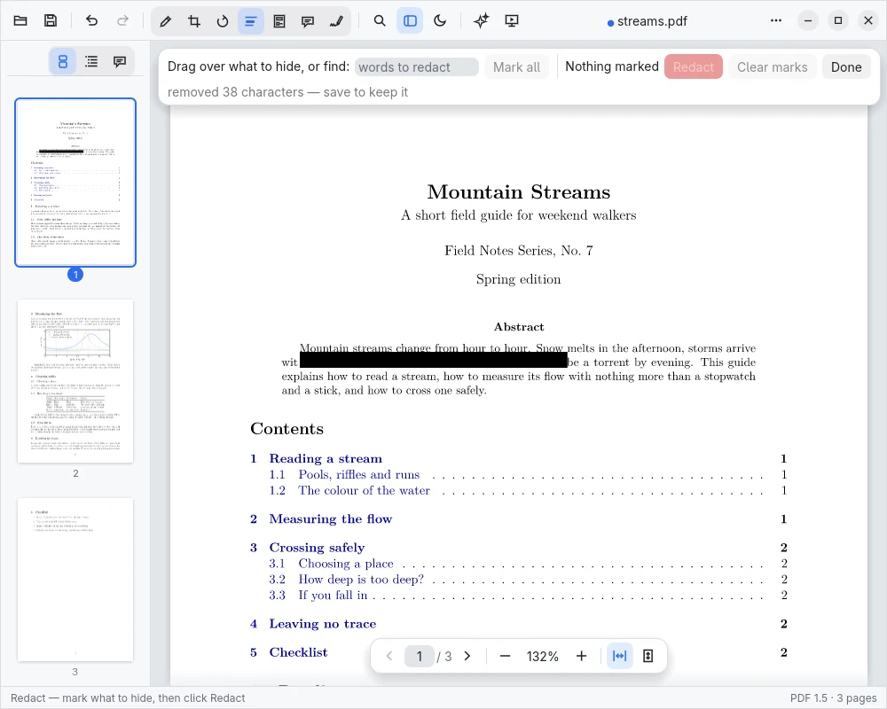</picture></a>
      <h3>Redact for good</h3>
      What is under the black box is removed from the file.
    </td>
  </tr>
  <tr>
    <td width="33%" valign="top">
      <a href="https://kabilanma.github.io/k-pdf/guide.html#pages"><picture><source media="(prefers-color-scheme: dark)" srcset="site/static/images/rotate-dark.webp">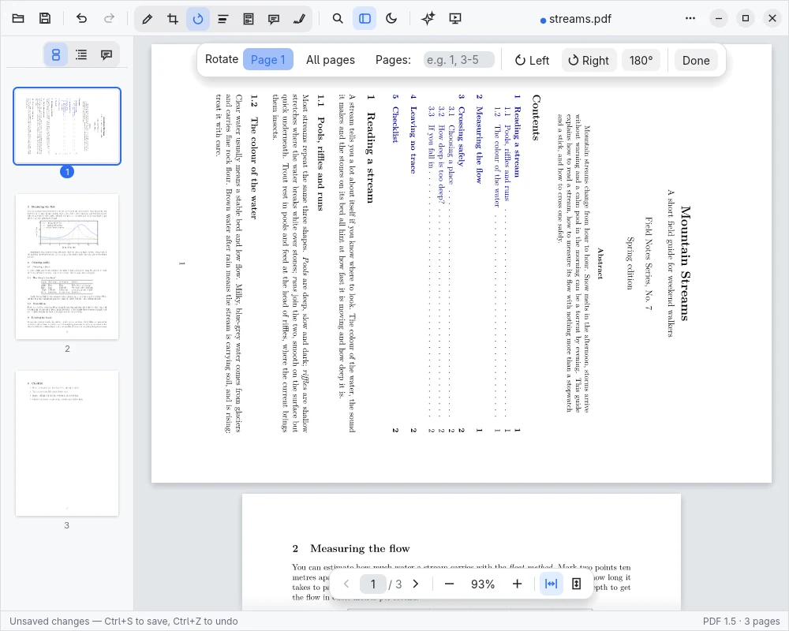</picture></a>
      <h3>Arrange pages</h3>
      Reorder, insert, delete, rotate and crop pages.
    </td>
    <td width="33%" valign="top">
      <a href="https://kabilanma.github.io/k-pdf/guide.html#present"><picture><source media="(prefers-color-scheme: dark)" srcset="site/static/images/print-dark.webp">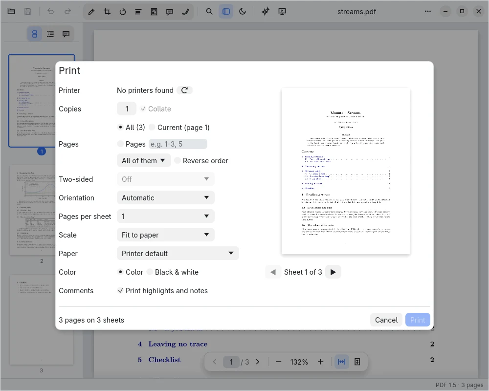</picture></a>
      <h3>Present and print</h3>
      Full-screen slides with a presenter view, and printing with a preview.
    </td>
    <td width="33%" valign="top">
      <a href="https://kabilanma.github.io/k-pdf/guide.html#dark-pages"><picture><source media="(prefers-color-scheme: dark)" srcset="site/static/images/dark-pages-dark.webp">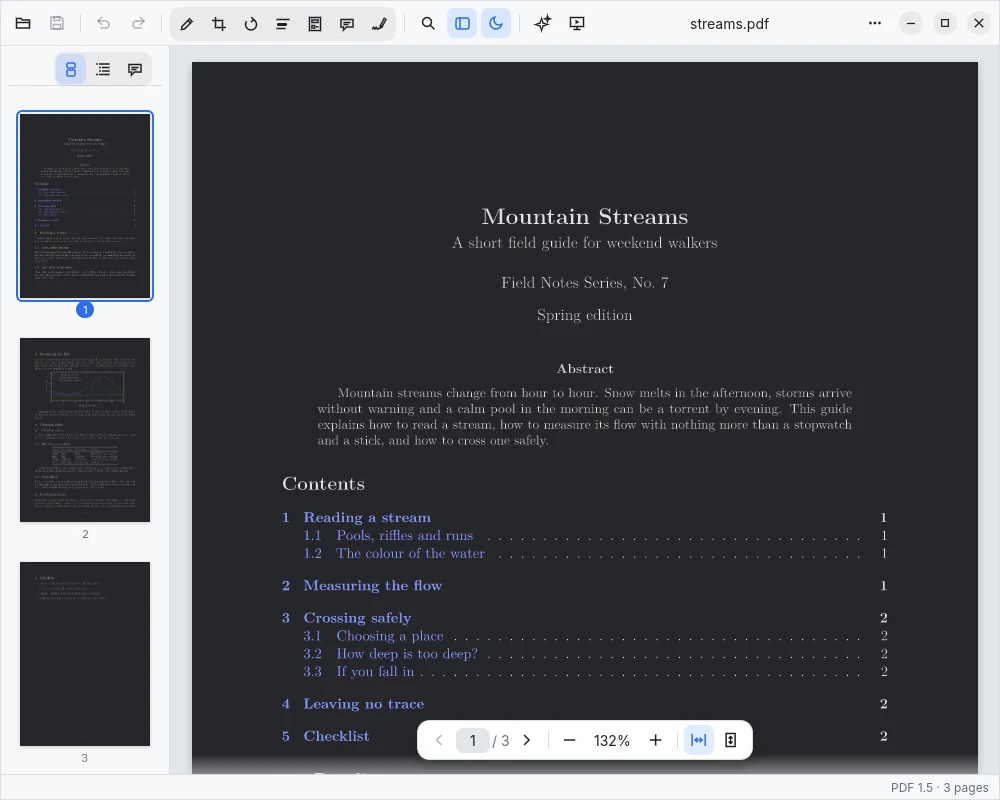</picture></a>
      <h3>Dark pages for reading</h3>
      Light text on soft gray; photos keep their real colors.
    </td>
  </tr>
</table>

<details>
<summary><b>Everything k-pdf can do, in detail</b></summary>

<br>

- **Read** — smooth scrolling, page thumbnails, zoom, clickable links, and text you can select and copy.
- **Open password-protected PDFs** — k-pdf asks for the password (the eye button shows what you typed) and opens the file. Everything works as usual: read, search, edit, sign, print. Saving keeps the same password, so the file stays protected. Files that are only protected against changes open without asking.
- **Find words** — Ctrl+F searches the whole document and highlights every match; Enter goes to the next. It also finds words in scanned pages, photos and pictures, which k-pdf reads with built-in text recognition (OCR), even when a page was scanned crooked, sideways or upside down. On scanned pages you can then select and copy the text too.
- **Pick up where you left off** — a file opens at the page and spot where you stopped reading it last time, even after closing k-pdf.
- **Jump between sections** — the sidebar lists a document's headings and subheadings and highlights the one you're reading. Long documents open on it, short ones on the page thumbnails; one click switches.
- **Edit text** — click any paragraph and type. The text keeps its font, size and color, and you can change those as in a word processor.
- **Highlight and comment** — select text to highlight it in one of four colors or comment on it, or drop a note anywhere on a page. The sidebar lists all the comments. They're saved as standard PDF comments, so other PDF readers show them too.
- **Fill in forms** — text fields, check boxes, radio buttons and lists. Fields you can fill in are shown in blue (a red border means it must be filled in); **Highlight fillable fields** in the ⋯ menu turns this off.
- **Create forms** — start from a blank page, or a PDF you have such as a paper form, and add text boxes, check boxes and drop-down lists that people can fill in. Drag to place a field, then move, resize, rename or delete it; other PDF readers can fill in the forms too.
- **Sign** — the pen button makes your signature three ways: **Draw** it on a white sheet with the mouse, a touchpad or a pen; **Type** your name and pick one of the handwriting fonts on your computer; or take it from a **Photo or scan** (an image or a PDF): drag a box around it, and the paper around it becomes see-through, leaving clean ink. Choose black or blue ink. Then drag it where it goes on the page and resize it by its corners; **Place** puts it there. Your signature is remembered while k-pdf is open, so you can sign several places quickly.
- **Rearrange pages** — drag thumbnails to reorder pages, insert another PDF between any two pages, or delete pages: one with the bin button on its thumbnail, or a list like "2, 5-7" with **Delete pages…** in the ⋯ menu.
- **Turn images into a PDF** — open JPEG, PNG, GIF, BMP, TIFF or WebP images just like a PDF: each image is a page, with thumbnails in the sidebar to add more images, reorder them or remove them. For each page, choose how it looks: **As is** keeps the image unchanged, while the scan looks turn a phone photo of a document into a clean scanned page. k-pdf finds the page in the photo, flattens it, straightens slanted text and removes shadows, so the paper is white and the writing crisp (**Color scan**, **Gray scan** or **Black & white**; **Cropped** only cuts the page out). Drag the corners if the page wasn't found exactly, then **Save PDF** to put all the pages in one PDF, and **Open PDF** to read the result. You can add PDFs too: their pages join the others, kept exactly as they are (text stays selectable) or cleaned up like a scan. Images can also be added to a PDF you have open (**Insert pages or images…** in the ⋯ menu, or the **+** between thumbnails): they open in the same editor first, so you can scan and crop each one, then **Insert** adds them as pages.
- **Clean up handwritten and scanned PDFs** — the sparkle button in the toolbar (or **Clean up scanned pages…** in the ⋯ menu) shows the document's pages as they are; pick a look for the ones that need it (**Apply to…** gives several pages the same look, like "1, 3-5" or all of them) and click **Apply**. The cleaned pages replace the old ones and you're back in the document with every other tool; Ctrl+Z undoes it. A blotchy, faint or grayish scan becomes clear and crisp. With **Handwriting** on, light pen and pencil strokes are darkened so every word is readable, the paper turns white, and a notebook's ruled lines stay light (and are left out entirely in black and white).
- **Crop** — one page, several, or all of them to the same area.
- **Rotate** — turn one page, a list of pages (like "1, 3-5"), or all of them.
- **Redact** — black out text, images or areas for good. Select some text and click **Redact** to mark it, or drag over any area. The text under the box is removed from the file, not just covered.
- **Present** — show the pages as full-screen slides with smooth fades between them, plus a presenter view with the next slide, your comments as speaker notes, and a timer. With two screens, the slides go on one and the presenter view on your main screen; you can switch them.
- **Print** — choose the printer, copies, which pages (all, the current one, a range like "1-3, 5", odd or even, in reverse), two-sided printing, several pages per sheet, scaling, paper size, black and white, and whether comments are printed, with a preview of each sheet. Unsaved changes are printed.
- **Compress** — make files smaller without losing any quality.
- **Undo and redo** everything, and save when you're ready.
- **Dark pages for reading** — the moon button turns pages dark: light text on a soft dark gray, with diagrams and colors kept recognizable (a light-blue box becomes a dark-blue one). Photos keep their real colors.
- **Light and dark themes** that follow your system.

It starts in a fraction of a second and uses little memory, even with large documents.

</details>

## Download

Get the latest version from the [Releases page](../../releases/latest):

| System | Download | How to install |
|---|---|---|
|  Windows 10 and 11 | `k-pdf-…-windows-x86_64.zip` | Unzip and run `k-pdf.exe`. If Windows SmartScreen warns you, choose **More info → Run anyway**. |
|  Apple Silicon and Intel | `k-pdf-…-macos-universal.dmg` | Open it and drag **k-pdf** into Applications. The first time, macOS blocks it: open **System Settings → Privacy & Security** and click **Open Anyway**. |
|  64-bit | `k-pdf-…-linux-x86_64.tar.gz` | Unpack it and run `./install.sh`. k-pdf then appears in your applications menu. Use `./install.sh --default` to make it your PDF app. |

> [!NOTE]
> Windows and macOS warn the first time you open k-pdf because it isn't signed with a paid developer certificate. The [install guide](https://kabilanma.github.io/k-pdf/guide.html#install) shows what to click.

## Using k-pdf

Open a PDF from the start screen, with **Ctrl+O** (**Cmd+O** on a Mac), or by dropping it onto the window. Dropping images turns them into the pages of a new PDF. The toolbar has the editing tools (**Edit text**, **Crop**, **Rotate**, **Redact**, **Form**, **Comment**), and the **⋯** menu has **Save as**, **Insert pages or images**, **Print**, **Compress**, document info and the theme.

<details>
<summary><b>Keyboard shortcuts</b></summary>

<br>

| Shortcut | Action |
|---|---|
| Ctrl+O | Open a file |
| Ctrl+S | Save |
| Ctrl+Shift+S | Save as |
| Ctrl+F | Find words (also in scans and pictures) |
| Enter / Shift+Enter, F3 / Shift+F3 | Next / previous match |
| Ctrl+P | Print |
| F5 / Shift+F5 | Present from the start / from this page (→ ← to move, B black screen, P presenter view, Esc to end) |
| Ctrl+Z / Ctrl+Shift+Z | Undo / redo |
| Ctrl+E | Edit text on or off |
| Ctrl+Shift+D | Dark pages for reading on or off |
| Ctrl+Shift+B | Sidebar: pages, sections or comments |
| Ctrl+Shift+H | Highlight the selected text |
| Ctrl+R / Ctrl+Shift+R | Rotate the current page right / left |
| Ctrl+C | Copy selected text |
| Ctrl + mouse wheel, Ctrl +/- | Zoom |
| Ctrl+0 / Ctrl+9 | Fit width / fit the whole page |
| Double-click a link | Go to that part of the document |
| Ctrl+click a web link | Open it in your browser |

On a Mac, use Cmd instead of Ctrl.

</details>

## Command line

k-pdf comes with **k-pdf-cli** for scripts and batch jobs: merge, reorder, crop, redact, compress, fill forms, sign, make PDFs from images or scan photos, extract text and more.

```sh
k-pdf-cli merge   combined.pdf a.pdf b.pdf
k-pdf-cli redact  in.pdf out.pdf --text "Jane Doe"
k-pdf-cli compress in.pdf smaller.pdf
k-pdf-cli compress in.pdf smallest.pdf --best           # tries harder: smaller, slower
k-pdf-cli images  album.pdf photo1.jpg drawing.png
k-pdf-cli scan    receipts.pdf photo1.jpg photo2.jpg --mode bw
k-pdf-cli scan    clean-notes.pdf notes.pdf --handwriting
k-pdf-cli search  scanned.pdf "invoice number"
k-pdf-cli blank   form.pdf a4
k-pdf-cli add-field form.pdf signup.pdf text "Full name" 1 72 100 400 124 --required
k-pdf-cli sign    contract.pdf signed.pdf 2 72 640 150 --from signature-photo.jpg --area 400,500,1900,850
k-pdf-cli sign    contract.pdf signed.pdf 2 72 640 150 --text "Jane Doe" --ink blue
k-pdf-cli text    locked.pdf --password "the password"     # any command reads protected files
k-pdf-cli decrypt locked.pdf unlocked.pdf --password "the password"
```

Run `k-pdf-cli --help` for everything it can do.

## Benchmarks

<!-- benchmarks:start -->
<!-- Generated by bench/bench.py. Edits between these markers are overwritten. -->

k-pdf compared with [MuPDF](https://mupdf.com), [poppler](https://poppler.freedesktop.org) (the engine of Evince, Okular and `pdftotext`), [Ghostscript](https://ghostscript.com) and the desktop viewers installed on the test machine, on 5 public documents (4,544 pages). Lower is better everywhere except the pixel match; the best result in each row is in bold.

| Task | k-pdf | MuPDF | poppler | Ghostscript |
|---|--:|--:|--:|--:|
| Render a page (time) | **37 ms** | 93 ms | 184 ms | 129 ms |
| Render a page (peak memory) | **27 MB** | 65 MB | 43 MB | 55 MB |
| Pixels matching MuPDF's render | **98.4%** | reference | 97.2% | 96.8% |
| Extract all text (time) | **74 ms** | 654 ms | 547 ms | – |
| Extract all text (peak memory) | **15 MB** | 54 MB | 40 MB | – |
| Merge 5 files, 4,544 pages (time) | **365 ms** | 1.1 s | 3.7 s | – |
| Merge (peak memory) | **134 MB** | 190 MB | 143 MB | – |
| Lossless compression (output size) | **97.8%** | 99.0% | – | – |
| Lossless compression (time) | 81 ms | **69 ms** | – | – |

Times are the median of several runs after a warm-up, as the wall-clock time of the whole command (starting the program, opening the file and writing the result). Values across documents are geometric means. Memory is the peak resident memory of the process.

### Rendering

<picture>
  <source media="(prefers-color-scheme: dark)" srcset="bench/results/render-dark.svg">
  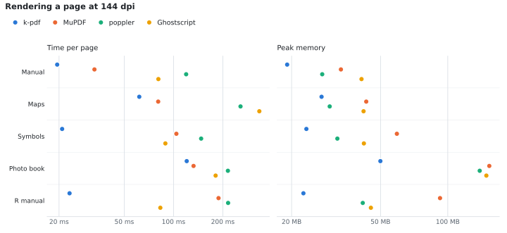
</picture>

Each tool is started once per page and writes a PNG at 144 dpi; the pages are spread from the first to the last (3 per document), or named in the corpus list (the photo book's photo is on page 3).

### Text extraction

<picture>
  <source media="(prefers-color-scheme: dark)" srcset="bench/results/text-dark.svg">
  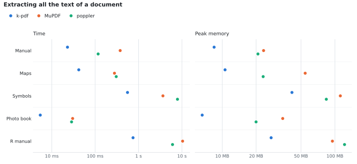
</picture>

`k-pdf-cli text`, `pdftotext` and `mutool draw -F txt`, all single-threaded.

### Compression

<picture>
  <source media="(prefers-color-scheme: dark)" srcset="bench/results/compress-dark.svg">
  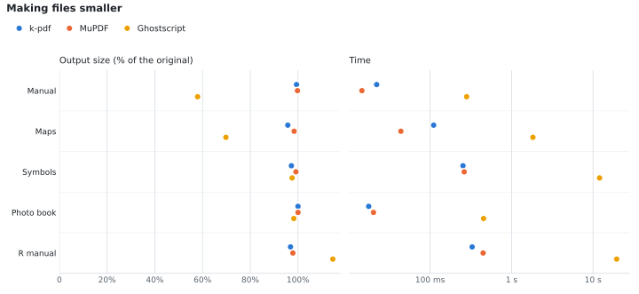
</picture>

k-pdf (`compress`, its default effort; `--best` is smaller still and slower), MuPDF (`mutool clean -gg -z -f -i -Z -e 100`; `-ggg` takes over 3 minutes on the R manual) and qpdf (when installed) keep every image and page exactly as it was. k-pdf recompresses images; MuPDF copies them as they are, which is faster on files that are mostly images. Ghostscript (`pdfwrite`) rebuilds the file and re-encodes images, so it is not lossless and is shown for reference only.

### Merging

<picture>
  <source media="(prefers-color-scheme: dark)" srcset="bench/results/merge-dark.svg">
  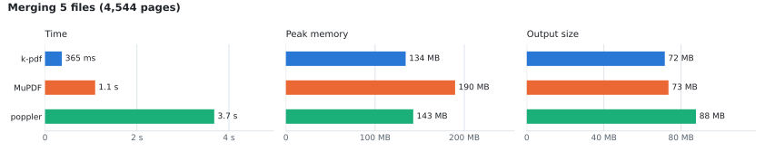
</picture>

All the documents merged into one, with `k-pdf-cli merge`, `mutool merge`, `pdfunite` and `qpdf --pages` (when installed). The inputs add up to 73 MB.

### Desktop app

<picture>
  <source media="(prefers-color-scheme: dark)" srcset="bench/results/viewer-dark.svg">
  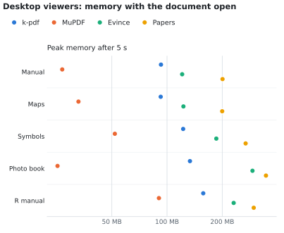
</picture>

Each viewer opens the document and is left alone for 5 seconds; the chart shows the peak memory of the app and its helper processes. The MuPDF viewer is a minimal window without a toolbar or sidebar. Time for k-pdf to start, open the document and show the first page:

| Document | Time to first page | Peak memory |
|---|--:|--:|
| Manual | 124 ms | 97 MB |
| Maps | 172 ms | 95 MB |
| Symbols | 131 ms | 123 MB |
| Photo book | 400 ms | 139 MB |
| R manual | 250 ms | 164 MB |

<details>
<summary>All the numbers, per document</summary>

**Rendering, time per page**

| Document | k-pdf | MuPDF | poppler | Ghostscript |
|---|--:|--:|--:|--:|
| Manual | **19 ms** | 33 ms | 119 ms | 81 ms |
| Maps | **62 ms** | 81 ms | 256 ms | 334 ms |
| Symbols | **21 ms** | 104 ms | 147 ms | 89 ms |
| Photo book | **120 ms** | 133 ms | 215 ms | 181 ms |
| R manual | **23 ms** | 188 ms | 215 ms | 83 ms |

**Rendering, peak memory**

| Document | k-pdf | MuPDF | poppler | Ghostscript |
|---|--:|--:|--:|--:|
| Manual | **19 MB** | 33 MB | 27 MB | 41 MB |
| Maps | **27 MB** | 43 MB | 30 MB | 42 MB |
| Symbols | **23 MB** | 59 MB | 32 MB | 42 MB |
| Photo book | **50 MB** | 153 MB | 139 MB | 149 MB |
| R manual | **23 MB** | 92 MB | 42 MB | 45 MB |

**Rendering, pixels that match** (each channel within 24 of 255)

| Document | Renderer | vs MuPDF | vs poppler |
|---|---|--:|--:|
| Manual | k-pdf | 97.6% | 96.9% |
| Manual | poppler | 96.9% | – |
| Manual | Ghostscript | 97.2% | 96.2% |
| Maps | k-pdf | 98.1% | 94.3% |
| Maps | poppler | 94.5% | – |
| Maps | Ghostscript | 92.8% | 90.6% |
| Symbols | k-pdf | 98.4% | 96.8% |
| Symbols | poppler | 97.2% | – |
| Symbols | Ghostscript | 98.1% | 96.4% |
| Photo book | k-pdf | 99.6% | 99.4% |
| Photo book | poppler | 99.7% | – |
| Photo book | Ghostscript | 98.5% | 98.6% |
| R manual | k-pdf | 98.2% | 97.4% |
| R manual | poppler | 97.9% | – |
| R manual | Ghostscript | 97.6% | 96.8% |

**Text extraction, time**

| Document | k-pdf | MuPDF | poppler |
|---|--:|--:|--:|
| Manual | **23 ms** | 377 ms | 117 ms |
| Maps | **42 ms** | 279 ms | 306 ms |
| Symbols | **556 ms** | 3.6 s | 7.9 s |
| Photo book | **5.4 ms** | 30 ms | 29 ms |
| R manual | **746 ms** | 10.4 s | 6.1 s |

**Text extraction, peak memory**

| Document | k-pdf | MuPDF | poppler |
|---|--:|--:|--:|
| Manual | **8.5 MB** | 23 MB | 21 MB |
| Maps | **11 MB** | 54 MB | 23 MB |
| Symbols | **42 MB** | 112 MB | 84 MB |
| Photo book | **6.6 MB** | 34 MB | 20 MB |
| R manual | **27 MB** | 95 MB | 122 MB |

**Text extraction, words in common** (F1 score of the words found)

| Document | Tool | vs MuPDF | vs poppler |
|---|---|--:|--:|
| Manual | k-pdf | 99.98% | 99.7% |
| Manual | poppler | 99.7% | – |
| Maps | k-pdf | 96.7% | 97.8% |
| Maps | poppler | 96.4% | – |
| Symbols | k-pdf | 97.7% | 98.1% |
| Symbols | poppler | 98.3% | – |
| Photo book | k-pdf | 98.7% | 98.9% |
| Photo book | poppler | 99.3% | – |
| R manual | k-pdf | 99.99% | 99.5% |
| R manual | poppler | 99.5% | – |

**Compression, output size** (Ghostscript is lossy, so it is not ranked)

| Document | k-pdf | MuPDF | Ghostscript |
|---|--:|--:|--:|
| Manual | **1.1 MB** | 1.2 MB | 0.7 MB |
| Maps | **24 MB** | 24 MB | 17 MB |
| Symbols | **22 MB** | 22 MB | 22 MB |
| Photo book | **14 MB** | 14 MB | 14 MB |
| R manual | **11 MB** | 11 MB | 13 MB |

**Compression, time**

| Document | k-pdf | MuPDF | Ghostscript |
|---|--:|--:|--:|
| Manual | 22 ms | **15 ms** | 281 ms |
| Maps | 111 ms | **44 ms** | 1.8 s |
| Symbols | **253 ms** | 262 ms | 12.0 s |
| Photo book | **18 ms** | 20 ms | 453 ms |
| R manual | **328 ms** | 448 ms | 19.5 s |

**Merging**

| Tool | Time | Peak memory | Output size |
|---|--:|--:|--:|
| k-pdf | 365 ms | 134 MB | 72 MB |
| MuPDF | 1.1 s | 190 MB | 73 MB |
| poppler | 3.7 s | 143 MB | 88 MB |

**Desktop viewers, peak memory**

| Document | k-pdf | MuPDF | Evince | Papers |
|---|--:|--:|--:|--:|
| Manual | 93 MB | **27 MB** | 121 MB | 201 MB |
| Maps | 92 MB | **33 MB** | 123 MB | 200 MB |
| Symbols | 122 MB | **52 MB** | 186 MB | 268 MB |
| Photo book | 133 MB | **25 MB** | 292 MB | 346 MB |
| R manual | 158 MB | **90 MB** | 231 MB | 297 MB |

**Documents** (listed in [bench/corpus.txt](bench/corpus.txt))

| Document | Pages | Size | What it is | File |
|---|--:|--:|---|---|
| Manual | 47 | 1.2 MB | 47-page manual: text, a few screenshots | `/usr/share/texlive/texmf-dist/doc/texlive/texlive-en/texlive-en.pdf` |
| Maps | 95 | 25 MB | 95 pages of vector maps and satellite images | `/usr/share/texlive/texmf-dist/doc/latex/mercatormap/mercatormap.pdf` |
| Symbols | 422 | 22 MB | 422 pages, hundreds of embedded fonts | `/usr/share/texlive/texmf-dist/doc/latex/comprehensive/symbols-a4.pdf` |
| Photo book | 18 | 14 MB | 18 pages with an 18-megapixel photo | `/usr/share/texlive/texmf-dist/doc/latex/willowtreebook/willowtreebook.pdf` |
| R manual | 3,962 | 11 MB | 3,962-page reference manual | `/usr/share/doc/R/manual/fullrefman.pdf` |

</details>

Measured on 2026-11-18 on Intel(R) Core(TM) Ultra 7 265 (20 threads, 31 GB RAM), Fedora Linux 43 (Workstation Edition), Linux 7.0.13-100.fc43.x86_64, with k-pdf v0.1.3-6-g3522614-dirty, MuPDF 1.27.2, poppler 25.07.0, Ghostscript 10.05.1, Evince 48.1, Papers 49.6. Rerun with `python3 bench/bench.py` (see the top of [bench/bench.py](bench/bench.py) for the options); it rebuilds k-pdf, measures everything again, redraws the charts and rewrites this section.

<!-- benchmarks:end -->

## Building from source

With [Rust](https://rustup.rs) and a C compiler installed:

```sh
cargo build --release --workspace
./target/release/k-pdf
```

On Linux, `packaging/linux/install.sh --link` adds it to your applications menu, linked to your build so every rebuild shows up.

To find words in images, also run `packaging/fetch-ocr-models.sh` once: it downloads the text-recognition models (about 12 MB), which the release downloads already include.

How k-pdf works inside, how to build releases and the website, the test results and the known limitations are in the [technical documentation](TECHNICAL.md).

## Roadmap

Planned work, roughly in order. Ideas and requests are welcome in the [issues](../../issues).

**Next up**
- [x] Show JPEG 2000 and JBIG2 images, common in scanned documents
- [ ] Make files much smaller by shrinking images, with a choice of quality
- [ ] Make scanned PDFs searchable in any app, by saving the recognized text into the file
- [ ] More ways to mark up: underline, strikethrough, freehand drawing, shapes and arrows, text boxes and stamps
- [ ] Two pages side by side, and one page at a time

**Reading**
- [ ] Several documents open at once, in tabs
- [ ] Selecting text across pages
- [ ] Right-to-left and Chinese, Japanese and Korean text, and finding words in scans in more languages
- [ ] Screen reader support and reading aloud
- [ ] More accurate colors (color profiles and smooth gradients)

**Editing**
- [ ] Watermarks, headers and footers, and page numbers
- [ ] Split a document, or save some of its pages as a new PDF
- [ ] Edit sections (bookmarks) and document details such as title and author
- [ ] Add or change a password
- [ ] Add and replace pictures on a page
- [ ] Save pages as images, or the document as a Word file
- [ ] Compare two versions of a document

**Further ahead**
- [ ] Digital signatures with a certificate, and checking the signatures in a file
- [ ] Forms that calculate and check what you type
- [ ] Saving as PDF/A for long-term archiving

## License

Licensed under either the [MIT license](LICENSE-MIT) or the [Apache License 2.0](LICENSE-APACHE), at your option.

<div align="center">
<br>

**Find k-pdf useful? Give it a ⭐ with the Star button at the top of the page.** It helps other people find the project.

</div>
